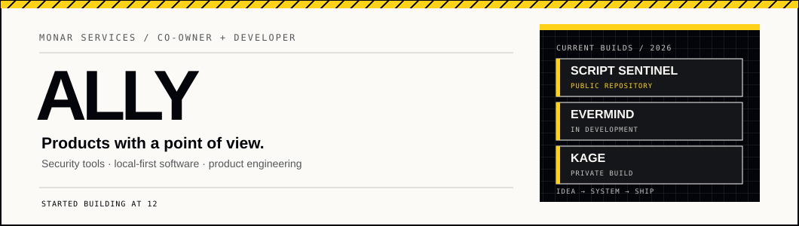

  <picture>
    <source media="(prefers-color-scheme: dark)" srcset="assets/ally-hero-dark.svg">
    
  </picture>

  <a href="https://www.monarservices.org">MONAR SERVICES</a> &nbsp; / &nbsp;
  <a href="https://github.com/Monar-HQ">MONAR HQ</a> &nbsp; / &nbsp;
  <a href="https://x.com/iamnotlol2">X · @iamnotlol2</a>

## I build the thing after the idea.

I’m Ally — developer and co-owner at [Monar Services](https://www.monarservices.org). I started coding at 12. These days, I turn ambitious ideas into software: shape the product, build the system, refine the interface, and keep going until the details hold up.

My work lives where **defensive security, local-first tools, and product engineering** meet. I care about software that feels considered, shows its evidence, and gives people clear control over what happens next.

## On the bench

<table>
  <tr>
    <td width="50%" valign="top">
      <strong>01 / SCRIPT SENTINEL</strong> 
      PUBLIC RELEASE PREPARATION · MONAR HQ
      
Local-first defense for the JavaScript your pages load. Inventory scripts, review integrity and CSP, and prepare verifiable changes for operator approval.

      <a href="https://github.com/Monar-HQ">VIEW MONAR HQ →</a>
    </td>
    <td width="50%" valign="top">
      <strong>02 / EVERMIND</strong> 
      IN DEVELOPMENT · MONAR HQ
      
Persistent, local memory for coding agents. Project decisions, constraints, and corrections carry across sessions instead of starting over.

      <a href="https://github.com/Monar-HQ">VIEW MONAR HQ →</a>
    </td>
  </tr>
</table>

**03 / KAGE** &nbsp; `PRIVATE BUILD` 
A phone-first product experience in development. More when it’s ready.

## MONAR, in public

The [Monar Services site](https://www.monarservices.org) puts the studio’s work in one place: three visual case studies, the 71-second **THIN AIR** launch film, and a brief flow designed to start with one sentence.
It’s the public face of the same product-minded work behind Script Sentinel.

## How I work

| PRODUCT | SYSTEMS | TRUST |
|:--|:--|:--|
| Start with the person and the problem. | Build tools that fit real workflows. | Keep evidence visible and changes reviewable. |
| Take an idea through interface and implementation. | Favor useful, local-first behavior. | Treat security as something to demonstrate. |

**Current toolkit:** Python · TypeScript · JavaScript 
**Current focus:** application security · coding-agent workflows · polished software

---

  <a href="https://www.monarservices.org">MONAR SERVICES</a> &nbsp; / &nbsp;
  <a href="https://github.com/Monar-HQ">PROJECTS</a> &nbsp; / &nbsp;
  <a href="https://x.com/iamnotlol2">SAY HELLO</a>

BUILD BOLDLY. VERIFY THE DETAILS.

